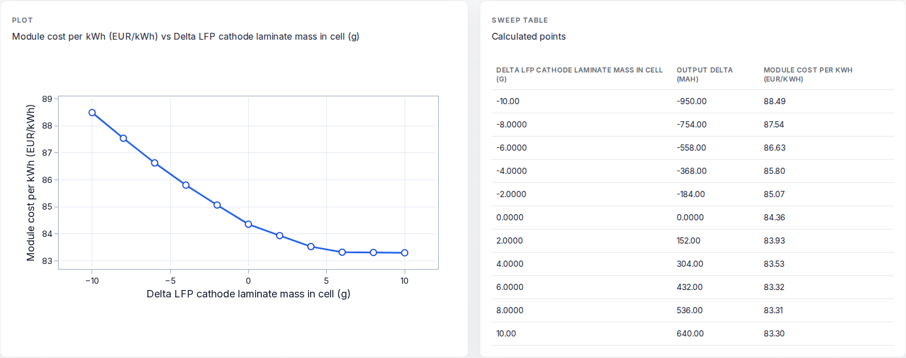
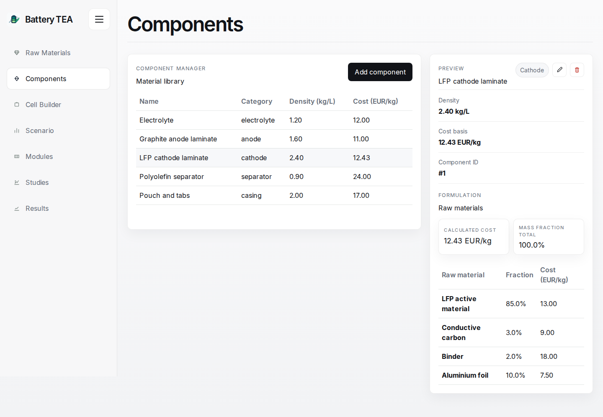
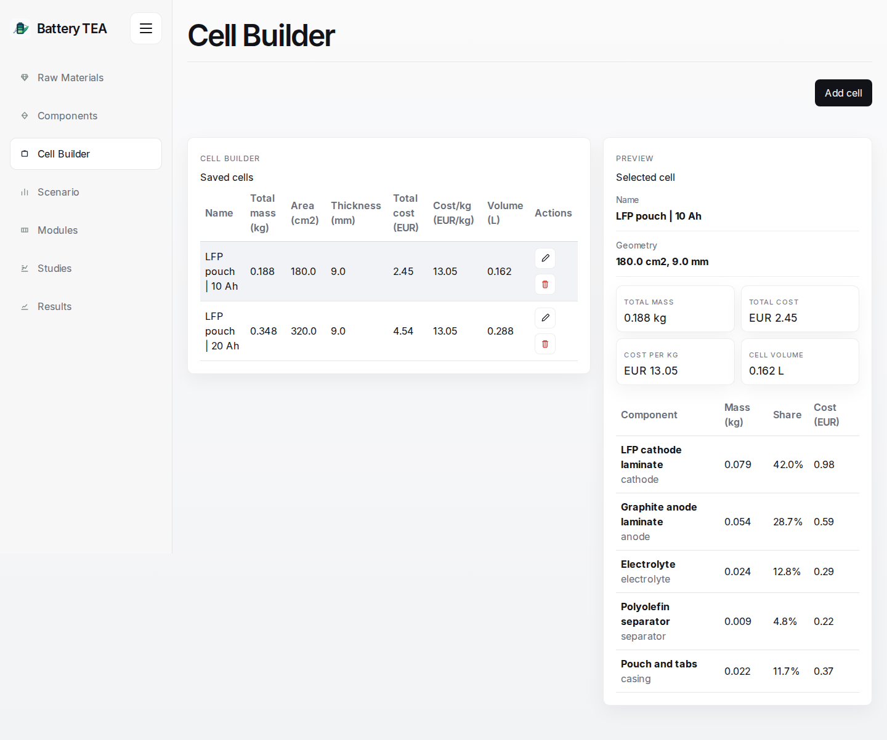
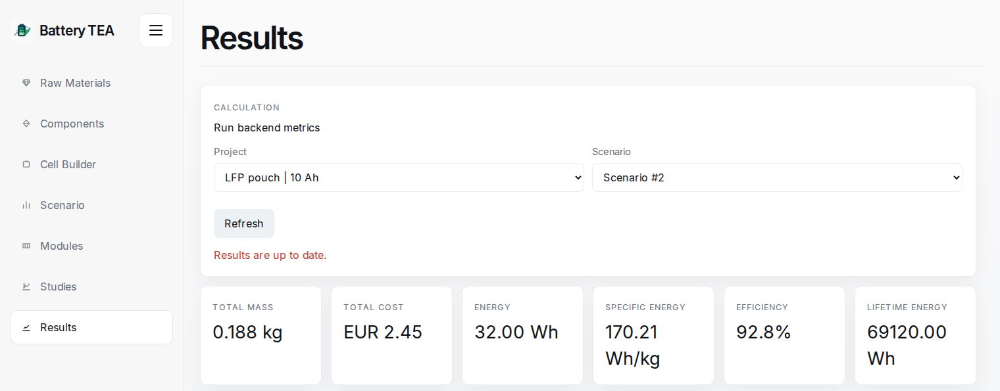
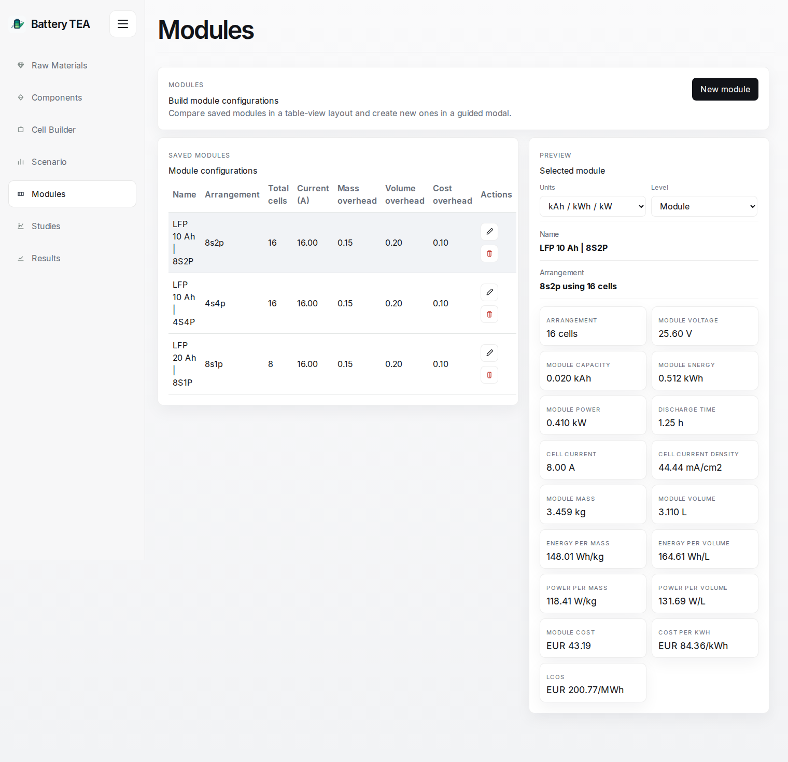

<div align="center">
  
  <h1>Battery TEA</h1>
  <p><strong>A techno-economic workbench for battery cells and modules</strong></p>
  <p>Build a cell bill of materials, enter performance assumptions, and see how cost, energy density, and lifetime economics change as you scale to a module.</p>
  <p>
    <a href="#workflow">Workflow</a> &middot;
    <a href="#worked-example">Worked example</a> &middot;
    <a href="#run-locally">Run locally</a> &middot;
    <a href="#model-and-code">Model and code</a>
  </p>
</div>

[](docs/images/sensitivity-study.png)

*Sensitivity study for a module built from an illustrative 10 Ah LFP pouch cell. The figures in this README use synthetic inputs, not measured performance or supplier quotes.*

## The modelling choice

**Cell composition and cost are defined separately from electrochemical performance.** The bill of materials records what goes into the cell and what it costs. The operating scenario takes average charge and discharge voltages, capacity, cycle life, and end-of-life retention directly from the user, alongside the electricity price. The same design can therefore be tested against measured, literature-based, or target performance without changing its bill of materials. In the base model, changing a formulation does not automatically change capacity or cycle life.

The **experimental Studies layer** reconnects these inputs through explicit, user-defined relationships. A lookup table can, for example, relate a change in cathode mass to a change in discharge capacity. A sweep then shows how that assumed response affects metrics such as module cost per kWh. The relationship stays visible and editable.

## Workflow

### 1. Price the materials and build the cell

Enter raw material prices and use mass fractions or mass parts to estimate a component cost. Apply that estimate or enter a component price directly. In **Cell Builder**, specify geometry and component masses to see where the cell's mass and cost come from.

| Component formulation | Cell bill of materials |
| :--- | :--- |
| [](docs/images/material-formulation.png) | [](docs/images/cell-builder.png) |

### 2. Set performance assumptions and calculate cell results

Create a scenario for the cell and inspect the resulting energy, Wh/kg, cost per nominal kWh, lifetime delivered energy, and simplified levelized cost of storage (LCOS).

[](docs/images/cell-results.png)

### 3. Compare module layouts and test sensitivities

Arrange identical cells in series and parallel, set module current, and specify separate overheads for mass, volume, and cost. Use **Modules** to compare voltage, power, discharge time, and module economics. In **Studies**, sweep a material or component mass change and inspect the calculated response at cell or module level.

[](docs/images/module-analysis.png)

## Worked example

What happens when the 10 Ah pouch cell becomes an **8S2P module** with 15% mass overhead, 20% volume overhead, and 10% cost overhead?

| Metric | One cell | 16-cell module |
| :--- | ---: | ---: |
| Nominal energy | 32 Wh | 512 Wh |
| Specific energy | 170.21 Wh/kg | 148.01 Wh/kg |
| Cost per nominal kWh | EUR 76.69/kWh | EUR 84.36/kWh |
| Simplified LCOS | EUR 197.22/MWh | EUR 200.77/MWh |

The module stores 16 times the energy. Packaging mass lowers its Wh/kg and integration cost raises its EUR/kWh. The **Results** page reports the cell baseline; **Modules** reports the configured module with its overheads.

## Run locally

With [Docker Compose](https://docs.docker.com/compose/) installed, run this from the repository root:

```bash
docker compose up --build
```

Open the [app](http://localhost:3000) or the [interactive API docs](http://localhost:8000/docs).

<details>
<summary><strong>Local development with SQLite and the screenshot dataset</strong></summary>

Use Python 3.12+ and Node.js 20+. From the repository root:

```bash
python -m venv backend/.venv
source backend/.venv/bin/activate
python -m pip install -r backend/requirements.txt
npm install
npm --prefix frontend install
npm run dev
```

On Windows PowerShell, activate the environment with `backend\.venv\Scripts\Activate.ps1` instead of `source`. The backend launcher applies migrations automatically. SQLite is the default for local development; set `DATABASE_URL` to use PostgreSQL.

Once the API is running, load the illustrative cells, modules, and sensitivity model from a second terminal:

```bash
python docs/seed_demo.py
```

The loader requires an empty database and exits if it finds existing records. Use a fresh SQLite instance for this demo: the Docker configuration already seeds example components. To reproduce the study screenshot, choose the **LFP 10 Ah | 8S2P** module, open **Sweep Results**, and select **Module cost per kWh** as the Y metric.

For checkouts that provide `npm run setup:backend`, that script can replace the manual virtual environment setup. Those checkouts also accept `PYTHON_BOOTSTRAP` for setup and `BACKEND_PYTHON` for the dev launcher.

</details>

## Model and code

- **Interface:** [Next.js and TypeScript](frontend/src/app), with Plotly for study curves.
- **API and data:** [FastAPI and SQLAlchemy](backend/app), with SQLite for local development, PostgreSQL in Compose, and Alembic migrations.
- **Model:** [Cell and module calculations](backend/app/calculations.py) are separate from [study correlations and sweeps](backend/app/services/study_service.py).

Battery TEA is designed for early screening and comparison. Module calculations assume identical cells and proportional integration overheads. The simplified LCOS divides modelled cell or module cost plus charging electricity by estimated lifetime delivered energy. It does not model discounted cash flows, manufacturing yield, replacements, or site-level equipment.
